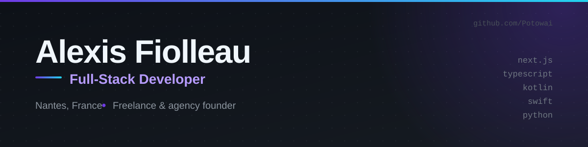

  

 

> **EN summary** — Full-stack developer in Nantes, France, and founder of **[Nervure](https://nervure.agency)**, a web agency. I build production websites, mobile apps and internal automations for French SMEs — mostly **TypeScript / Next.js**, with **Kotlin** and **Swift** for native work and **Python** for data & back-office tooling. Current focus: SEO- and AI-search-optimised sites for local businesses, and desktop tooling for AI coding agents. The rest of this page is in French.

---

## 🇫🇷 À propos

**Alexis Fiolleau** — développeur full-stack à **Nantes**, fondateur de **Nervure**, agence web & développement.

Je construis des **sites web en production**, des **applications mobiles** et des **automatisations** pour des PME et des indépendants. Stack principal : **TypeScript / Next.js / React / Tailwind**, avec **Kotlin** et **Swift** pour le natif, **Python** pour la data et l'outillage interne, **PostgreSQL** côté données.

Concrètement, ce que j'apporte :

- **Du design au déploiement** — je conçois, je code, je mets en ligne. Pas d'intermédiaire, pas de sous-traitance.
- **SEO technique *et* GEO** — les sites sont pensés pour Google **et** pour les moteurs de réponse (AI Overviews, ChatGPT, Perplexity) : JSON-LD, contenu structuré, balisage sémantique.
- **Accessibilité & performance** — Lighthouse 90+, navigation clavier, contrastes vérifiés, images optimisées.
- **Livraison rapide et prévisible** — site vitrine en 7–10 jours, projet complet en 2–3 semaines, démos à chaque sprint.

---

## 🚀 Projets en vedette

<table>
  <tr>
    <td width="33.33%" valign="top">
      <b>🩺 Psychomotricité Nantes</b> 
      Site vitrine &amp; ressource — refonte WordPress  
      SEO + GEO, accessibilité soignée, multilingue, sans cookie ni traceur. Pensé d'abord pour que les gens contactent.  
      <code>Next.js 16</code> <code>React 19</code> <code>Tailwind v4</code> <code>JSON-LD</code>  
      <a href="https://psychomotricite-nantes.vercel.app">Site en ligne</a> · <a href="https://github.com/Potowai/psychomotricite-nantes">Code</a>
    </td>
    <td width="33.33%" valign="top">
      <b>🖥️ Atelier Fiolleau</b> 
      Dépannage informatique — Nantes  
      Site vitrine de 46 pages statiques, SEO local sur 8 quartiers de Nantes, Schema.org, sitemap, CI/CD Playwright. Version publique enrichie : 3D, Mapbox, animations.  
      <code>Next.js</code> <code>React Three Fiber</code> <code>Mapbox</code> <code>Tailwind</code>  
      <a href="https://atelier-fiolleau.fr">Site en ligne</a> · <a href="https://github.com/Potowai/atelier-fiolleau-web-boost">Code</a>
    </td>
    <td width="33.33%" valign="top">
      <b>🎨 Portfolio</b> 
      Expérience interactive — Bento Grid &amp; WebGL  
      Portfolio en grille Bento avec scène WebGL, transitions et animations. Les projets s'y explorent au scroll, sans friction.  
      <code>Next.js 15</code> <code>React Three Fiber</code> <code>Three.js</code> <code>Tailwind</code>  
      <a href="https://alexisf.vercel.app">Site en ligne</a> · <a href="https://github.com/Potowai/portfolio">Code</a>
    </td>
  </tr>
  <tr>
    <td width="33.33%" valign="top">
      <b>📊 GitHub Copilot Tracker</b> 
      Widget Windows — crédits IA  
      Widget léger affichant le % de crédits Copilot et l'usage Claude Code en temps réel, avec contrôle depuis la zone de notification.  
      <code>Tauri</code> <code>Rust</code> <code>TypeScript</code>  
      <a href="https://potowai.github.io/github-copilot-tracker/">Doc & démo</a> · <a href="https://github.com/Potowai/github-copilot-tracker">Code</a>
    </td>
    <td width="33.33%" valign="top">
      <b>⏱️ Codex Session Widget</b> 
      Widget Windows 11 — quota Codex  
      Widget flottant : % de quota restant sur la fenêtre 5 h, compte à rebours de réinitialisation, barre hebdomadaire, icône système.  
      <code>Python</code> <code>Tkinter</code> <code>Swift</code>  
      <a href="https://github.com/Potowai/codex-session-widget">Code</a>
    </td>
    <td width="33.33%" valign="top">
      <b>🔀 OmniRoute Quickstart</b> 
      Passerelle LLM multi-fournisseurs  
      Script d'installation en une commande : passerelle LLM locale exposant 700+ modèles derrière une API OpenAI-compatible, branchée sur OpenCode.  
      <code>Shell</code> <code>OpenCode</code> <code>OpenAI-compatible</code>  
      <a href="https://github.com/Potowai/omniroute-quickstart">Code</a>
    </td>
  </tr>
</table>

---

## 🛠️ Stack

**Langages** — TypeScript · JavaScript · Python · Kotlin · Swift · Java · SQL (PostgreSQL) · Shell · Rust · HTML/CSS

**Front-end** — Next.js · React · Tailwind CSS · Astro · Vue · React Three Fiber  
**Back-end & données** — Node.js · Bun · Prisma · PostgreSQL · PL/pgSQL · Python  
**Mobile & desktop** — Kotlin (Android) · Swift (iOS/macOS) · Tauri · Electron · Tkinter  
**Outils** — Git · GitHub Actions · Docker · Vercel · Linux · Playwright

---

## 📊 Activité GitHub

  
  
  

---

## 🧩 Autres projets

| Projet | Description |
| :--- | :--- |
| **[RateBench](https://github.com/Potowai/RateBench)** | Application mobile-first pour répertorier, noter et photographier les bancs publics et spots de repos remarquables. Android (Kotlin) + PWA + Supabase. |
| **[ETL Open Food Facts](https://github.com/Potowai/etl-off)** | Import de ~13 000 produits Open Food Facts en base H2, partitionnement parallèle, API REST de consultation. Java 21 + virtual threads. |
| **[AI Benchmark & Price Explorer](https://github.com/Potowai/improved-system)** | Compare les Elo de Chatbot Arena et les prix d'API pour plus de 110 LLM, avec backend SQLite et API REST Flask. |
| **[GiftRadar](https://github.com/Potowai/giftradar)** | Radar de concours PWA installable, flux réindexé deux fois par jour par GitHub Actions, suivi local des participations. |
| **[PackClair DE](https://github.com/Potowai/packclair-de)** | PWA *local-first* de déclaration d'emballage LUCID : confidentialité et automatisation métier avant tout. |
| **[Prospect Finder](https://github.com/Potowai/prospect-finder)** | Scraping Google Maps et génération automatique de landing pages personnalisées, export SQLite dédupliqué. |
| **[Cat Years](https://github.com/Potowai/cat-years)** | L'âge réel de votre chat en années humaines, calculé avec une rigueur très scientifique. |
| **[PokemonDLE](https://github.com/Potowai/PokemonDLE)** | Wordle Pokémon : recherche floue, navigation clavier, curseur flottant, localisation française. |
| **[Neon Atlas](https://github.com/Potowai/NeoGuessr)** | Jeu de devinette géographique façon arcade : image satellite, indices, carte néon et points à marquer. |
| **[Traffic Light Widget](https://github.com/Potowai/traffic-light-widget)** | Widget Windows 11 qui transforme l'activité de votre agent de code en feu tricolore. Sans texte, sans bruit. |
| **[Home Dashboard](https://github.com/Potowai/home-dashboard)** | Tableau de bord pour piloter son infrastructure personnelle : serveur Minecraft, métriques système, accès centralisé. |
| **[Ansible Load Balancer](https://github.com/Potowai/ansible-loadbalancer-project)** | Configuration Ansible de load balancing, idempotente et versionnable. |
| **[Sépolia Voting](https://github.com/Potowai/sepolia-testnet-voting-system)** | Système de vote on-chain en Solidity, déployé sur le testnet Sépolia. |
| **[Personal Media Server](https://github.com/Potowai/Personal-Media-Server)** | Guide complet pour monter son serveur média personnel auto-hébergé, streaming et blocage de pubs. |

---

## 📬 Contact

**Disponible pour** — sites vitrines & e-commerce sur mesure, applications métier, automatisations, SEO technique, audit de performance.

**Nantes, France** · réponse sous 24 h

---

  Conçu et développé par Alexis Fiolleau — <a href="https://nervure.agency">Nervure</a>

